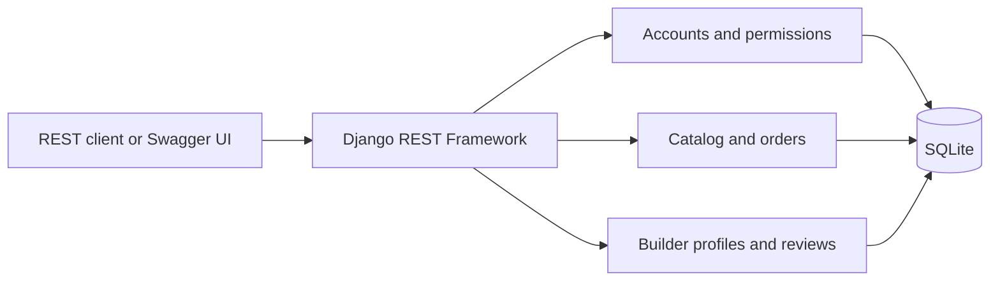
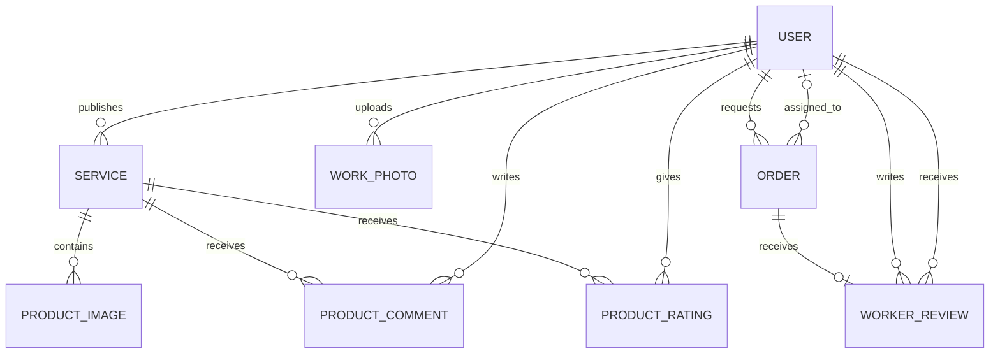

# 🏗️ Construction Services API

### Builder Directory, Service Catalog & Order Management

A Django REST Framework project that connects clients with builders. Clients browse services, submit orders, and review completed work. Builders manage their services, share work photos, and update assigned orders.

## 🛠️ Tech Stack

| Area | Technology |
|---|---|
| Language | Python 3.12+ |
| Backend | Django 6, Django REST Framework |
| Database | SQLite |
| Authentication | DRF token and Django session authentication |
| API documentation | OpenAPI and Swagger UI via drf-spectacular |
| Verification | Django tests and GitHub Actions |

## 🚀 Key Features

- Search active builder profiles and browse work photos.
- Manage service listings and add product images, comments, and ratings.
- Create orders as a client and track work as an assigned builder.
- Review a completed order once.
- Keep personal contact details and unassigned order addresses out of public or unrelated views.

## 📂 Architecture



The Django application is in `Qurilish_project-main/`. Configuration lives in `proyect/`. Business logic is grouped into `apps/users`, `apps/product`, `apps/orders`, and `apps/common`.

## 🗃️ Database Relationships



A service maps to the `Product` model. An order can start without a builder. Each user can rate a service once and can update that rating.

## 🔗 REST API

| Method | Path | Access |
|---|---|---|
| POST | `/api/users/register/`, `/api/users/login/` | Public |
| GET, PATCH | `/api/users/profile/` | Signed-in user |
| POST | `/api/users/logout/`, `/api/users/change-password/`, `/api/users/avatar/` | Signed-in user |
| GET | `/api/products/`, `/api/products/{id}/` | Public catalog |
| POST | `/api/products/` | Builder |
| PUT, PATCH, DELETE | `/api/products/{id}/` | Service owner |
| POST | `/api/products/{id}/comment/`, `/api/products/{id}/rate/` | Signed-in user |
| POST | `/api/products/{id}/images/` | Service owner |
| GET | `/api/orders/`, `/api/orders/{id}/` | Client or builder within their order scope |
| POST | `/api/orders/` | Client |
| PATCH | `/api/orders/{id}/` | Builder within their order scope |
| GET | `/api/common/workers/`, `/api/common/workers/{id}/`, `/api/common/workers/{id}/photos/`, `/api/common/workers/{id}/reviews/` | Public |
| POST | `/api/common/workers/{id}/reviews/` | Client who owns the completed order |
| POST | `/api/common/photos/upload/` | Builder |
| GET | `/api/docs/`, `/api/schema/` | Swagger UI and OpenAPI schema |

## ⚙️ Local Development

Run these commands in PowerShell using Python 3.12 or newer.

```powershell
git clone --branch portfolio/construction https://github.com/Zuhriddin07-01/Construction.git
cd Construction/Qurilish_project-main
python -m venv .venv
.\.venv\Scripts\python.exe -m pip install -r requirements.txt
$env:DJANGO_SECRET_KEY = .\.venv\Scripts\python.exe -c "import secrets; print(secrets.token_urlsafe(48))"
$env:DEBUG = "true"
.\.venv\Scripts\python.exe manage.py migrate
.\.venv\Scripts\python.exe manage.py runserver
```

Open [Swagger UI](http://127.0.0.1:8000/api/docs/). Register or log in, then authorize requests with the returned token using `Authorization: Token <key>`. Image uploads use multipart form data. The optional `.env.example` lists the local settings.

## 🧪 Checks

```powershell
.\.venv\Scripts\python.exe manage.py check
.\.venv\Scripts\python.exe manage.py makemigrations --check --dry-run
.\.venv\Scripts\python.exe manage.py test
.\.venv\Scripts\python.exe manage.py spectacular --file schema.yml --validate --fail-on-warn
```

## 👨‍💻 Author

**Zuhriddin Nosirov** · [GitHub profile](https://github.com/Zuhriddin07-01)
